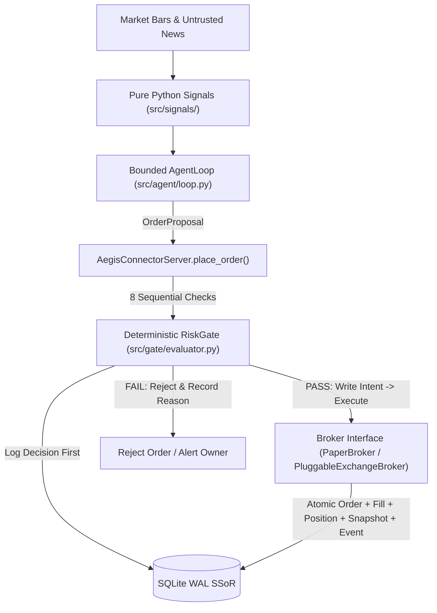

# AEGIS: Autonomous Execution with Governed Investment Safeguards

[](https://github.com/abdulhayykhan/AEGIS/actions/workflows/ci.yml)
[](https://www.python.org/downloads/release/python-3120/)
[](https://mypy-lang.org/)
[](https://docs.astral.sh/ruff/)
[](https://opensource.org/licenses/MIT)

> **An AI Trading Digital FTE that acts inside deterministic limits it cannot change.**  
> Built by [Abdul Hayy Khan](https://abdulhayykhan.dev) (`@abdulhayykhan`), following the spec-driven, human-supervised engineering practices of *The AI Agent Factory (Panaversity)*, v2.

> [!WARNING]
> **Risk & Readiness Notice**: Most retail trading strategies lose money. AEGIS is currently a **well-tested paper trading simulator and deterministic Risk Gate harness** (`180` passing tests). Live real-money trading is **NOT** enabled yet: `PluggableExchangeBroker` currently routes to `PaperBroker`, `AgentLoop` uses `MockLLMClient` by default, and live exchange REST execution, venue-resident OCO stops, and multi-week calendar testnet evidence are still required before connecting funded accounts.

---

## Table of Contents

1. [What is AEGIS?](#1-what-is-aegis)
2. [Six-Layer Architecture](#2-six-layer-architecture)
3. [Deterministic Risk Gate (DSoR) Limits](#3-deterministic-risk-gate-dsor-limits)
4. [Repository Structure](#4-repository-structure)
5. [Unified CLI (`aegis`) Reference](#5-unified-cli-aegis-reference)
6. [Configuration & Role-Separated Secrets](#6-configuration--role-separated-secrets)
7. [Operations, Supervision & Docker](#7-operations-supervision--docker)
8. [Phase Roadmap & Honest Readiness Status](#8-phase-roadmap--honest-readiness-status)
9. [Installation, Development & Verification](#9-installation-development--verification)
10. [Open-Source Foundations & Citations](#10-open-source-foundations--citations)

---

## 1. What is AEGIS?

**AEGIS** (Autonomous Execution with Governed Investment Safeguards) is a governed trading worker designed around one core invariant: **permissions, not prompts, keep capital safe**.

Unlike unconstrained trading bots or raw LLM agents:
- **Hard Limits Outside the Model**: All risk checks, position sizing, daily loss limits, peak drawdown halts, price sanity bands, and idempotency guards run in pure deterministic Python (`src/gate/`) using exact `Decimal` arithmetic — **zero LLM involvement**.
- **Single-Owner Governance**: Built for one owner ([Abdul Hayy Khan](https://abdulhayykhan.dev)). Protected security boundaries (`src/gate/`, `docs/risk-policy.md`, `docs/authority-envelope.md`, `docs/role-contract.md`) are locked via `.github/CODEOWNERS` and `AGENTS.md`.
- **Untrusted Input Quarantine**: External market news is explicitly tagged `trust="untrusted"`, scanned for prompt injection patterns (`src/agent/news_sanitizer.py`), and summarized without order-execution privileges.
- **Persistent Audit Trail & Crash Recovery**: Orders, fills (with realized P&L), positions (with `stop_loss` and `take_profit`), gate decisions, equity snapshots, reconciliations, approvals, demotions, and immutable `event_ledger` events persist in SQLite WAL (`src/storage/db.py`).
- **Progressive Autonomy Ladder**: Authority progresses strictly through four rungs (**Observe → Recommend → Draft → Execute**) gated by verifiable database evidence (`ops/check_promotion_criteria.py`).

---

## 2. Six-Layer Architecture

AEGIS separates reasoning, knowledge, state, and execution across six distinct layers:

| Layer | Location | Responsibility & Current Implementation |
|---|---|---|
| **1. Model + Harness** | `src/agent/` | Bounded trading loop (`AgentLoop`: max `12` turns, `$1.00` cost cap, `300s` timeout), optional multi-agent deliberation (`TradeCouncil`), untrusted news sanitizer, and `BaseLLMClient` (currently `MockLLMClient` for deterministic offline/CI testing). |
| **2. Skill** | `skills/` | Markdown/YAML playbooks (`trading-run`, `multi-agent-debate`, `market-regime-detection`, `onchain-intelligence`, `price-action-and-liquidity`, `incident-postmortem`). |
| **3. KSoR (Knows)** | `docs/` | Versioned Knowledge of Record: PRD, Role Contract, Authority Envelope, Risk Policy, Strategy Spec, Runbook, and Go-Live Checklist. |
| **4. Memory (Remembers)** | Ephemeral / Scratch | Non-authoritative cycle context. Never trusted for balances, positions, or risk limits. |
| **5. SSoR (Tracks)** | `src/storage/db.py` & `src/migrations/` | System of Record: SQLite (WAL mode, `data/aegis.db`, Migrations 1–3) storing `runs`, `proposals`, `gate_decisions`, `orders`, `fills`, `positions`, `equity_snapshots`, `demotions`, `event_ledger`, `reconciliations`, and `approvals`. PostgreSQL schema DDL is also maintained in `src/migrations/001_initial_schema.sql`. |
| **6. DSoR (Acts)** | `src/gate/` & `src/connector/` | Deterministic System of Record: `RiskGate` (8 sequential checks), `StandaloneKillSwitch` (out-of-band lock file), `reconcile_states`, and `AegisConnectorServer` (10 MCP tools, zero forbidden transfer/withdraw tools). |

### Execution Flow



---

## 3. Deterministic Risk Gate (DSoR) Limits

All limits below are enforced deterministically in `GateConfig` (`src/gate/evaluator.py`) and `OrderProposal` (`src/gate/models.py`):

| Safeguard | Code-Enforced Value | Behavior on Breach |
|---|---|---|
| **Max Risk Per Trade** | **1.0%** of account equity (`max_risk_pct = 0.01`) | Rejected (`abs(price - stop_loss) * size <= 0.01 * equity`). Reduce-only exits exempt. |
| **Max Position Per Instrument** | **10.0%** of account equity (`max_position_pct = 0.10`) | Rejected if existing + new notional `> 0.10 * equity`. Reduce-only exits exempt. |
| **Max Total Portfolio Exposure** | **50.0%** of account equity (`max_exposure_pct = 0.50`) | Rejected if total notional exposure `> 0.50 * equity`. |
| **Max Concurrent Open Positions** | **3** instruments (`max_open_positions = 3`) | New symbol entry rejected if 3 positions already open. |
| **Max Orders Per UTC Day** | **10** orders/day (`max_orders_per_day = 10`) | New risk-adding orders rejected at `>= 10` daily orders. Reduce-only exits exempt. |
| **Max Daily Realized Loss** | **2.0%** of account equity (`max_daily_loss_pct = 0.02`) | New risk-adding entries blocked; reduce-only exits allowed. |
| **Max Drawdown From Peak Equity** | **10.0%** (`max_drawdown_pct = 0.10`) | New entries blocked when `(peak_equity - equity) / peak_equity >= 0.10`. |
| **Allowed Order Types** | `LIMIT`, `STOP_LOSS_LIMIT` | `MARKET` orders unconditionally rejected by Risk Gate. |
| **Shorting / Margin / Leverage** | **Disabled** | `SELL` without held position or `size > held_position` rejected. |
| **Data Freshness** | `<= 2` bar intervals | Rejected if market data is missing or older than `2 * bar_interval`. |
| **Price Sanity Band** | `±2.0%` (`price_sanity_pct = 0.02`) | Rejected if limit price deviates `> 2.0%` from latest mark price. |
| **Idempotency & Replay Guard** | UUID per proposal + single-use approval nonce | Duplicate proposal execution or reused idempotency/nonce rejected. |
| **Live Approval (`LIVE_WITH_APPROVAL`)** | Canonical HMAC-SHA256 / Ed25519 signature | Raw owner secret rejected; requires valid signature over full order + `expires_at` + `nonce`. |

---

## 4. Repository Structure

```text
AEGIS/
├── AGENTS.md                        # Immutable operating rules for coding agents
├── pyproject.toml                   # Python 3.12+ dependencies, Ruff, Pytest, Mypy strict config
├── Dockerfile                       # Non-root production container image (entrypoint: aegis)
├── docker-compose.yml               # Container orchestration setup
├── .env.example                     # Role-separated environment & secrets template
├── .gitleaks.toml                   # Secret-scanning configuration
├── .github/
│   ├── CODEOWNERS                   # Mandatory @abdulhayykhan review on safety boundaries
│   └── workflows/ci.yml             # CI: Gitleaks, pip-audit, Ruff, Mypy strict, Pytest
├── src/
│   ├── cli.py                       # Unified `aegis` CLI entrypoint
│   ├── agent/                       # Bounded AgentLoop, TradeCouncil, NewsSanitizer, PlaybookLoader, LLMClient
│   ├── connector/                   # AegisConnectorServer (MCP tools) & Broker interface
│   ├── gate/                        # RiskGate (DSoR), StandaloneKillSwitch, Reconciler, Models
│   ├── signals/                     # SMA, ATR, RSI, Bollinger, FVG, Regime, On-Chain, Sizing, Strategy
│   ├── reports/                     # Independent P&L/fee recomputation verifier
│   ├── storage/db.py                # SQLite WAL persistent engine & ledger reconstruction (Migrations 1-3)
│   └── migrations/                  # PostgreSQL reference DDL (001_initial_schema.sql)
├── ops/
│   ├── scheduler.py                 # AutonomousScheduler ("ran is not worked" 6-check runner + file lock)
│   ├── alerts.py                    # Telegram dispatcher & external dead-man's switch heartbeat
│   ├── telegram_bot.py              # Two-way authenticated Telegram command handler & offset poller
│   ├── dashboard.py                 # Markdown & structured operational risk dashboard
│   ├── status_server.py             # Read-only HTTP telemetry server (/health, /status, /positions, /report)
│   ├── check_promotion_criteria.py  # Autonomy promotion gate verifier
│   ├── weekly_report.py             # Per-symbol paired trade performance reporter
│   ├── cron.sh                      # Scheduled runner shell script
│   ├── run_paper_simulation.py      # 56-day Phase 6 simulation harness
│   └── run_live_approval_simulation.py # 28-day Phase 7 approval simulation harness
├── backtest/                        # Zero-lookahead BacktestEngine, WFO, Monte Carlo, real Binance historical bars
├── skills/                          # Modular agent playbooks (SKILL.md files)
├── docs/                            # Governance specs, reports, runbook, checklist, citations
└── tests/                           # 180 tests: unit, property, contract, planted_bugs, replay, redteam, chaos
```

---

## 5. Unified CLI (`aegis`) Reference

Installed as a console script via `pyproject.toml` (`aegis = "src.cli:main"`):

```bash
# View operational risk budgets, equity, drawdown, and reconciliation status
aegis dashboard

# Execute one autonomous trading cycle (modes: RECOMMEND_ONLY, PAPER_EXECUTION, LIVE_WITH_APPROVAL, FULL_AUTONOMY)
aegis run --mode PAPER_EXECUTION

# Verify database ledger vs broker state reconciliation
aegis reconcile

# Engage / disengage the out-of-band Emergency Kill Switch
aegis kill --reason "Manual supervisor intervention" --owner "Abdul Hayy Khan"
aegis kill --disengage --owner "Abdul Hayy Khan" --token "$AEGIS_OWNER_SECRET"

# Emergency flatten: cancel open orders and close all open positions with reduce-only sells
aegis flatten --owner "Abdul Hayy Khan" --token "$AEGIS_FLATTEN_SECRET"

# Resolve an active demotion incident after root-cause remediation
aegis restore --incident INC-XXXX --owner "Abdul Hayy Khan" --token "$AEGIS_RESTORE_SECRET"

# Check database evidence against autonomy promotion criteria
aegis promote --target PAPER_EXECUTION

# Generate weekly performance & fee report from immutable fills ledger
aegis report
```

---

## 6. Configuration & Role-Separated Secrets

Copy `.env.example` to `.env` (never commit `.env` — it is gitignored and scanned by Gitleaks):

| Variable | Purpose |
|---|---|
| `AEGIS_EXECUTION_MODE` | `RECOMMEND_ONLY`, `PAPER_EXECUTION`, `LIVE_WITH_APPROVAL`, or `FULL_AUTONOMY` |
| `AEGIS_DB_PATH` | Optional SQLite database path override (default: `data/aegis.db`) |
| `AEGIS_OWNER_SECRET` | Master fallback owner credential |
| `AEGIS_APPROVAL_SECRET` / `AEGIS_APPROVAL_PUBLIC_KEY` | Dedicated secret or Ed25519 public key for `LIVE_WITH_APPROVAL` order signatures |
| `AEGIS_KILL_SWITCH_SECRET` | Dedicated credential reserved for kill-switch disengagement |
| `AEGIS_RESTORE_SECRET` | Dedicated credential for `aegis restore` demotion resolution |
| `AEGIS_FLATTEN_SECRET` | Dedicated credential for `aegis flatten` emergency liquidation |
| `AEGIS_TELEGRAM_BOT_TOKEN` | Telegram Bot API token for alerts and supervisor commands |
| `AEGIS_TELEGRAM_CHAT_ID` / `AEGIS_TELEGRAM_USER_ID` | Authorized owner Telegram chat & user IDs (fail-closed if unset) |
| `AEGIS_HEARTBEAT_WEBHOOK_URL` | External Dead-Man's Switch webhook (e.g., Healthchecks.io) |
| `EXCHANGE_API_KEY` / `EXCHANGE_API_SECRET` / `EXCHANGE_TESTNET` | Spot trade-only exchange credentials (withdrawals/transfers disabled at venue) |

---

## 7. Operations, Supervision & Docker

- **Autonomous Scheduler (`ops/scheduler.py`)**: Acquires an atomic process lock (`scheduler.lock` with 1-hour stale-lock recovery) and verifies **6 mandatory conditions** every cycle: data freshness, pre-reconciliation, agent cycle execution, gate audit logging, post-reconciliation, and independent P&L/fee recomputation. Any safety violation in live modes triggers automatic demotion to `RECOMMEND_ONLY` stored in SQLite `demotions`.
- **Two-Way Telegram Supervisor (`ops/telegram_bot.py`)**: Supports `/status`, `/positions`, `/approve <proposal_id>`, `/pause`, and `/kill <reason>`, authenticating both `chat_id` and `user_id`, persisting the update offset in `data/telegram_offset.txt`.
- **Status HTTP Server (`ops/status_server.py`)**: Exposes `/health`, `/status`, `/positions`, and `/report` JSON endpoints.
- **Docker**: `Dockerfile` runs as non-root user `aegis` (UID `1000`). See `docker-compose.yml` for containerized execution.

---

## 8. Phase Roadmap & Honest Readiness Status

AEGIS follows the phased build sequence in `docs/prd.md` Section 17:

- [x] **Phase 0: Specification & Governance** — Role Contract, Authority Envelope, Risk Policy, Strategy Spec, Runbook, `AGENTS.md`, `CODEOWNERS`.
- [x] **Phase 1: Data & Signals** — Pure-Python indicators (`SMA`, `ATR`, `RSI`, `Bollinger`, `FVG`), regime classification, 1% risk / 10% cap sizing, deterministic replay verified.
- [x] **Phase 2: Backtest Harness** — Zero-lookahead `BacktestEngine` (0.10% fee, 0.05% slippage, gap-through stops), Walk-Forward Optimization, Monte Carlo (`docs/backtest-report.md`).
- [x] **Phase 3: Deterministic Risk Gate (DSoR)** — 8 sequential gate checks, Hypothesis property tests, planted-bug mutation tests, standalone kill switch.
- [x] **Phase 4: MCP Connector Server** — `AegisConnectorServer` with 10 gated tools and zero forbidden transfer/withdraw tools (`tests/contract/test_mcp_connector.py`).
- [x] **Phase 5: Bounded Agent (Recommend-Only)** — 12-turn / `$1.00` cap / `300s` timeout loop, prompt-injection red-team suite, independent P&L recomputation.
- [x] **Phase 6: Paper Execution & Operations (Harness Validated)** — 56-day simulation harness passed (`docs/paper-execution-report.md`). *Real multi-week testnet calendar run pending.*
- [x] **Phase 7: Small Live with Approval (Harness Validated)** — 28-day simulation harness + signed approval checks (`docs/live-approval-report.md`). *Real venue deployment pending.*
- [x] **Phase 8: Full Autonomy (Governance Ready)** — Persistent demotion invariant verified (`tests/unit/test_full_autonomy.py`). *Earned only after Phase 6 & 7 live evidence.*
- [x] **Phase 9: Hardening & Review Remediations** — SQLite WAL persistence, `aegis` CLI, Gitleaks + `pip-audit` blocking CI, protective-stop persistence, atomic order/fill/event transactions, cryptographic order signatures with expiry & single-use nonces, and tripartite reconciliation proofs.

---

## 9. Installation, Development & Verification

### Prerequisites
- Python **3.12+**
- [`uv`](https://docs.astral.sh/uv/) (recommended) or `pip`

### Setup

```bash
git clone https://github.com/abdulhayykhan/AEGIS.git
cd AEGIS

# Create virtual environment and install package + dev dependencies
uv venv --python 3.12
.venv\Scripts\activate          # Windows
# source .venv/bin/activate     # Linux / macOS

uv pip install -e ".[dev]"
```

### Run Verification Suite (Matches `.github/workflows/ci.yml`)

```bash
# Full test suite (180 tests across unit, property, contract, planted_bugs, replay, redteam, chaos, backtest)
pytest -v

# Lint & formatting
ruff check .

# Strict static type checking across all 98 source & test files
mypy src tests backtest ops
```

---

## 10. Open-Source Foundations & Citations

AEGIS integrates architectural patterns from eight open-source research and trading projects (full mapping in [docs/references-and-citations.md](docs/references-and-citations.md)):

- **[TauricResearch/TradingAgents](https://github.com/TauricResearch/TradingAgents)** — Multi-agent deliberation council (`src/agent/council.py`)
- **[tradermonty/claude-trading-skills](https://github.com/tradermonty/claude-trading-skills)** — ICT 3-bar Fair Value Gaps & price action (`src/signals/price_action.py`)
- **[nansen-ai/nansen-cli](https://github.com/nansen-ai/nansen-cli)** — On-chain whale accumulation & exchange netflow scoring (`src/signals/onchain.py`)
- **[agiprolabs/claude-trading-skills](https://github.com/agiprolabs/claude-trading-skills)** — Market regime classification & adaptive gating (`src/signals/regime.py`)
- **[marian2js/trading-skills](https://github.com/marian2js/trading-skills)** — Wilder RSI, Bollinger Bands, multi-timeframe alignment (`src/signals/multitimeframe.py`)
- **[mattpocock/skills](https://github.com/mattpocock/skills)** — Modular YAML/Markdown `SKILL.md` playbooks (`skills/`)
- **[daviddme/TradingView-Unified-MCP](https://github.com/daviddme/TradingView-Unified-MCP)** & **[tradingview-indicator-search-mcp-server](https://github.com/daviddme/tradingview-indicator-search-mcp-server)** — Standardized technical summary MCP interface (`get_technical_summary`)

---

## License

MIT License — Owner: [Abdul Hayy Khan](https://abdulhayykhan.dev).
