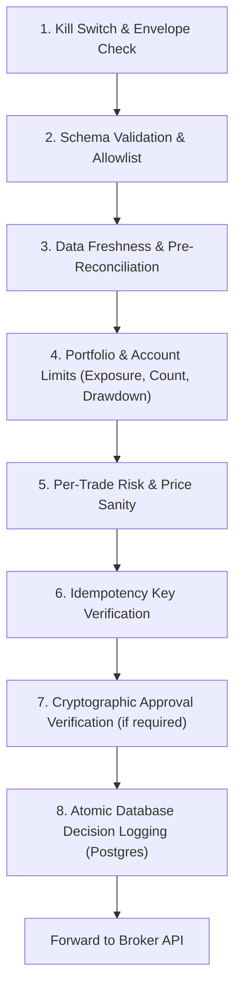

# AEGIS Risk Policy and Risk Gate (DSoR) Specification

> **Guarded File**: Protected by CODEOWNERS. The AI coding agent is forbidden to modify this file without an explicit owner instruction and reviewed pull request.
> **Enforcement Mechanism**: Deterministic Python code (`src/gate/`) with **no LLM calls, prompts, or heuristics**.

---

## 1. Quantitative Risk Limits (D9)

All monetary calculations use minor currency units (e.g., cents/sats) or exact fixed-point `Decimal` (`NUMERIC`), **never binary floating-point numbers** (`float`).

| Limit Parameter | Default Setting | Action on Breach |
|---|---|---|
| **Max Risk Per Trade** | **1.0%** of account equity | Order rejected. Equation: `abs(entry_price - stop_loss) * size <= 0.01 * equity` |
| **Max Position Per Instrument** | **10.0%** of account equity | Order rejected if `(existing_position_value + new_order_value) > 0.10 * equity` |
| **Max Total Portfolio Exposure** | **50.0%** of account equity | Order rejected if total notional exposure across all open positions > `0.50 * equity` |
| **Max Concurrent Open Positions**| **3** instruments | Order rejected if opening a new position would exceed 3 concurrent positions |
| **Max Orders Per 24h Window** | **10** orders | Order rejected once 10 non-exempt orders are logged within the UTC day |
| **Max Daily Loss Limit** | **2.0%** of account equity | **Immediate self-halt**: cancel all pending orders, reject all new risk-adding proposals, alert owner |
| **Max Drawdown From Peak Equity**| **10.0%** from peak equity | **Emergency self-halt**: new entries frozen, requires explicit owner inspection & unlock |
| **Allowed Order Types** | `LIMIT`, `STOP_LOSS_LIMIT` | `MARKET` orders are strictly prohibited except when executing an emergency Kill Switch |
| **Leverage / Margin / Shorting** | **DISABLED** | Any order requesting leverage > 1.0 or borrowing/shorting is unconditionally rejected |
| **Data Freshness** | ≤ 2 bar periods old | Order rejected if latest market bar timestamp is older than `2 * bar_interval` |
| **Price Sanity Band** | ±2.0% of last mark price | Order rejected if limit price deviates > 2.0% from the verified last traded price |
| **Duplicate Guard** | Unique UUID v4 idempotency key | Order rejected if idempotency key is already recorded in SQLite WAL (`data/aegis.db`) or in-memory executed set |
| **Execution Mode Flag** | `PAPER` or `LIVE` | Set via environment variable outside model. `LIVE` strictly requires an owner-signed flag file |

---

## 2. Deterministic Gate Evaluation Sequence

Every order request submitted to the Risk Gate must be evaluated against the following strict 8-step pipeline in order. If any step fails, evaluation terminates immediately, the failure reason is recorded in PostgreSQL `gate_decisions`, and an actionable error is returned.

1. **Step 1: Kill Switch & Mode Validation**:
   - Check if kill switch flag is active. If active, abort.
   - Verify execution mode against active authority envelope for the current phase.
2. **Step 2: Schema Validation & Allowlist**:
   - Verify request payload against strict Pydantic schema (reject extra/unknown fields).
   - Ensure instrument symbol is on the pre-approved whitelist in `instruments` table (`allowed = true`).
3. **Step 3: Freshness & Reconciliation Check**:
   - Verify that latest bar data was fetched within 2 bar durations.
   - Run pre-trade reconciliation: verify PostgreSQL cached account equity and positions equal broker API state.
4. **Step 4: Portfolio Limits**:
   - Check open position count (< 3).
   - Check UTC daily order count (< 10 for risk-adding orders; reduce-only exits exempt).
   - Check daily P&L: if current daily loss ≥ 2.0%, trigger daily loss halt for new entries.
   - Check peak equity drawdown: if peak drawdown ≥ 10.0%, trigger drawdown halt for new entries.
   - Check total portfolio exposure (notional ≤ 50% equity).
   - Check instrument position size (notional ≤ 10% equity).
5. **Step 5: Per-Trade Risk & Price Sanity**:
   - Ensure explicit `stop_loss` is provided.
   - Compute monetary risk: `abs(entry - stop_loss) * size`. Must be ≤ 1% equity (reduce-only exits exempt).
   - Compute price sanity: `abs(limit_price - last_price) / last_price`. Must be ≤ 0.02.
6. **Step 6: Idempotency Verification**:
   - Check `proposals` / executed order tracking for `idempotency_key` and `proposal_id`. Must not exist.
7. **Step 7: Approval Check (if `LIVE_WITH_APPROVAL`)**:
   - Verify canonical cryptographic signature (HMAC-SHA256 or Ed25519) over order parameters + `expires_at` + single-use `nonce`, and persist in SQLite `approvals` table. Raw owner secrets are rejected.
8. **Step 8: Persistent Audit Write Before Broker Transmission**:
   - Persist pass/reject status, detailed check metrics, and timestamp to SQLite `gate_decisions` (schema aligned with `src/migrations/001_initial_schema.sql`).
   - Only upon successful database commit may the order intent be logged and dispatched to the broker API connector.

---

## 3. Emergency Kill Switch Specification

The Kill Switch is an out-of-band safety mechanism designed to protect capital under extreme conditions.
- **Trigger Mechanisms**:
  1. CLI command: `aegis kill --reason "..." --owner "Abdul Hayy Khan"`
  2. Telegram Bot command: `/kill <reason>`
  3. Automatic trigger by Risk Gate / Scheduler on unhandled exception or 10.0% drawdown breach.
- **Immediate Actions Taken**:
  1. Sets atomic persistent lock file (`data/aegis_kill_switch.lock`).
  2. Cancels all pending orders across all venues immediately.
  3. Optionally liquidates open positions via `aegis flatten --token ...`.
  4. Dispatches emergency priority alerts to [Abdul Hayy Khan](https://abdulhayykhan.dev) via Telegram.
  5. Refuses all subsequent requests from the agent loop.
- **Deactivation**:
  - The AI worker can never clear the kill switch.
  - Reset requires manual owner intervention via CLI with explicit confirmation credentials.

---

## 4. Owner Sign-off

- **Owner**: [Abdul Hayy Khan](https://abdulhayykhan.dev)
- **Signature**: `[PENDING OWNER SIGNATURE: [Abdul Hayy Khan](https://abdulhayykhan.dev)]`
- **Date**: 2026-11-22
