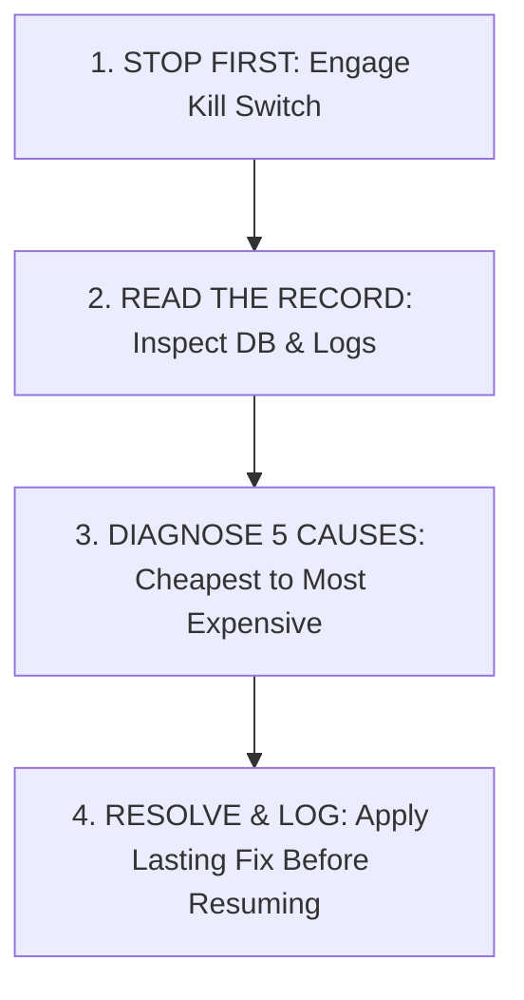

# AEGIS Incident & Operations Runbook

> **Operational Guidelines by [Abdul Hayy Khan](https://abdulhayykhan.dev)**  
> **Framework**: *The AI Agent Factory (Panaversity)*, Ch. 11.1, 11.3, 15.2, 15.4

---

## 1. Emergency Procedures: When Something Goes Wrong

If an alert fires, anomalous behavior is observed, or market conditions require manual intervention, follow the **Four-Step Emergency Protocol**:



### Step 1: Stop First (Engage the Kill Switch)
Do not try to reason with or debug a running trading process. Freeze execution first.
- **Option A (Telegram Bot)**: Click the `[🚨 EMERGENCY KILL SWITCH]` button.
- **Option B (CLI)**:
  ```bash
  python -m src.gate.kill_switch --engage --reason "Operator manual intervention"
  ```
- **What this does**:
  1. Activates the persistent atomic kill flag.
  2. Dispatches cancellation calls for all open orders across all venues.
  3. Optionally executes market closing orders if position liquidation is flagged.
  4. Blocks any subsequent orders from the agent loop.

### Step 2: Read the Record
Examine the immutable system state recorded in PostgreSQL:
1. Check the last run:
   ```sql
   SELECT * FROM runs ORDER BY started_at DESC LIMIT 1;
   ```
2. Check recent gate decisions:
   ```sql
   SELECT * FROM gate_decisions ORDER BY decided_at DESC LIMIT 5;
   ```
3. Check recent incidents:
   ```sql
   SELECT * FROM incidents ORDER BY ts DESC LIMIT 5;
   ```
4. Check reconciliation diffs:
   ```sql
   SELECT * FROM reconciliations WHERE match = false ORDER BY ts DESC;
   ```

### Step 3: Diagnose the Five Causes (Cheapest First)
When debugging unexpected agent behavior, investigate in order of increasing cost and complexity (Book Ch. 11.3):
1. **Brief**: Did the scheduled brief change, or did it specify ambiguous parameters?
2. **Inputs**: Was market data stale, missing bars, or corrupted? Did an untrusted news item inject confusion?
3. **Permissions**: Did an authority envelope mismatch block expected behavior?
4. **Tools / Connector**: Did the broker API timeout, rate-limit, or return unexpected error payloads?
5. **Model**: Did the LLM fail to follow format schemas, hallucinate citations, or hit context limits?

### Step 4: Fix One Lever, Test, and Make it Lasting
- Never resolve an issue solely by prompting the agent in chat.
- Fix one lever at a time.
- Implement a lasting fix: add a unit test that captures the defect, update deterministic validation code, or update system configuration.
- Log an incident entry in `incidents` with root cause and remediation.

---

## 2. Rehearsed Recovery & Restart Procedure

To safely resume operations after an incident or halt:
1. Verify the root cause is resolved and verified by a passing test.
2. Verify broker positions and PostgreSQL database are 100% synchronized:
   ```bash
   python -m src.gate.reconcile --verify
   ```
3. Clear the kill switch state via owner credentials:
   ```bash
   python -m src.gate.kill_switch --disengage --owner "Abdul Hayy Khan"
   ```
4. Run a single manual check in Recommend-Only mode:
   ```bash
   python -m src.agent.run --mode recommend_only
   ```
5. Confirm green health check before re-enabling automated scheduler.

---

## 3. Daily Operational Checklist for the Owner

- [ ] Check morning Telegram heartbeat and summary alert.
- [ ] Verify 0 reconciliation mismatches reported in the last 24 hours.
- [ ] Verify total daily model API expenditure is within budget (< $1.00/day).
- [ ] Review any warnings (e.g. daily loss approaching 80% threshold).
